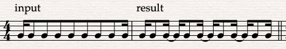
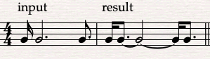
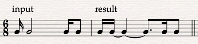
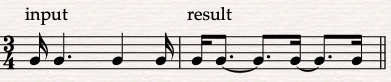

# Split at Beat Boundaries

A Sibelius ManuScript plug-in for re-spelling sustained notes across beat boundaries. It splits notes and chords, adds ties, and spells rests using separate rules. In places where the same duration can be written with fewer ties, it checks whether the fragments can be regrouped without hiding a required boundary.

Supported meters: **2/4, 3/4, 4/4, 6/8, 9/8 and 12/8**. A passage containing any other meter is rejected before any edits are made.

The rules reflect a particular engraving preference. This is not a general-purpose rhythm quantizer or a replacement for checking the resulting notation.

## Install

Download the repository ZIP and extract it, or use a local checkout. Keep the `.plg` file beside the installer.

- **macOS:** double-click `Install-macOS.command`.
- **Windows:** double-click `Install-Windows.cmd`.

Restart Sibelius, then look for **Split at Beat Boundaries** under **Home → Plug-ins → Custom**. You can also assign it a shortcut in Sibelius Preferences.

The installers copy the plug-in into the current user's plug-in folder and overwrite a previous copy with the same name. They do not require an administrator account, download dependencies, or alter the score. If macOS refuses to execute the script, copy the `.plg` file manually instead.

| System | Destination |
| --- | --- |
| macOS | `~/Library/Application Support/Avid/Sibelius/Plugins/Custom/` |
| Windows | `%APPDATA%\Avid\Sibelius\Plugins\Custom\` |

Create the `Custom` folder if it does not exist. The plug-in filename is `SplitAtBeatBoundaries.plg`. When updating from `SplitAtBeatBoundaries050.plg`, the installers keep the old file as a numbered `.disabled` backup so Sibelius does not load both copies. For manual installation, move the old file out of the plug-in folder.

To uninstall, remove that file from the plug-in folder and restart Sibelius.

## Use

1. Select one or more complete bars as a passage.
2. Run **Split at Beat Boundaries**.
3. Check the ties, beams and articulation placement.

Individual-note selections and partial bars are rejected. If there are no eligible changes, the message includes the number of notes and rests examined. Unsupported objects may be skipped even in a supported meter.

It does not collect an existing chain of tied notes and rewrite the chain as one event. Incoming ties are excluded by the eligibility check.

## Examples

Input is shown on the left; the result is on the right.

## Compatibility and limits

The target version is **Sibelius 2024.3** with ManuScript plug-in support. The plug-in uses Sibelius's installed `utils` helper plug-in; no Avid code is bundled here.

A full end-to-end run in the Sibelius interpreter has not been verified. Windows installation has not been tested on Windows.

The note eligibility check excludes tuplets, grace notes, irregular bars, tremolos, incoming ties, laissez-vibrer ties, slides, arpeggios, falls, scoops and certain live-playback overrides. Some exclusions apply to the whole voice in a bar. Full-bar rest consolidation has its own checks and preserves specialized rest presentation by declining to consolidate it.

Note and chord properties are copied with Sibelius helpers. Internal ties are added per pitch; the final fragment retains its outgoing tie. Beams are left to Sibelius. Attack articulations stay on the first fragment and fermatas on the last. Arbitrary attached notation has not been exhaustively tested.

## License

[MIT](LICENSE). The license covers this project's code and documentation, not Sibelius or its bundled helpers. This project is not affiliated with Avid.
